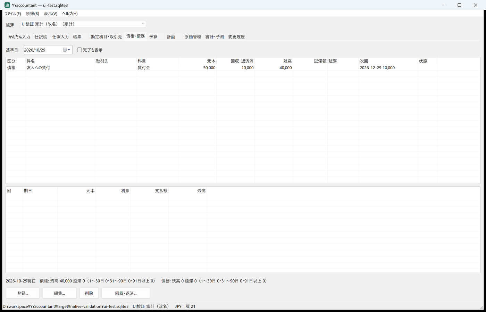
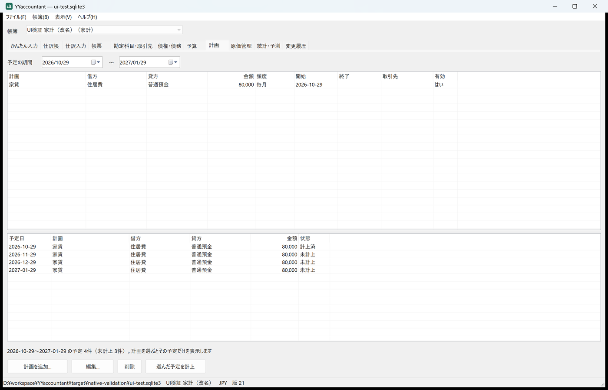
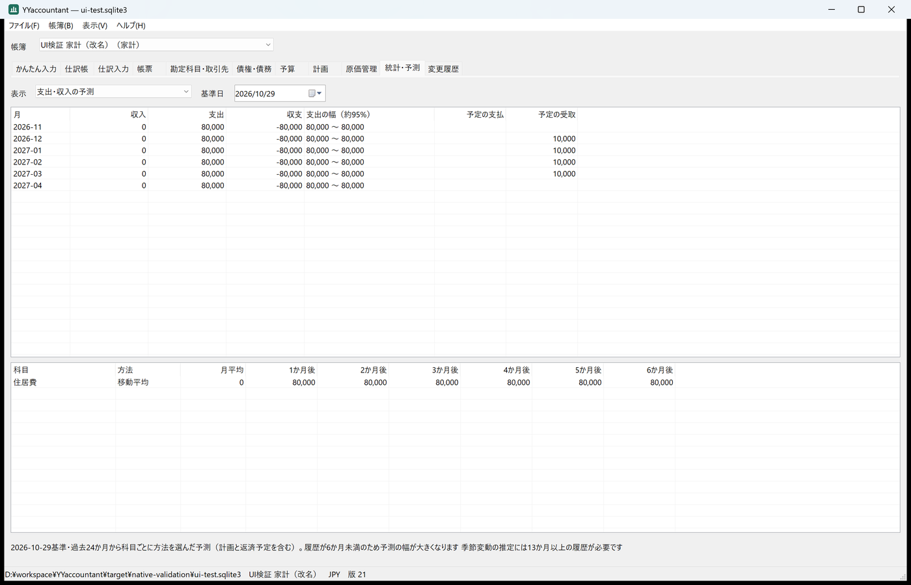
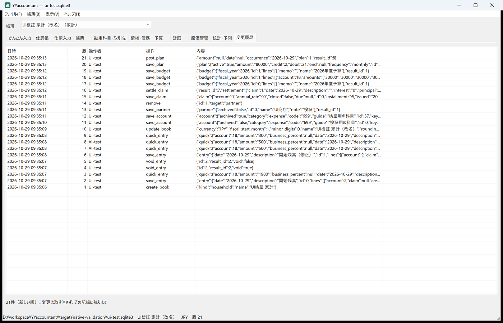

# ネイティブ画面への記録の画面の追加と検証（2026-10-29）

[最初のネイティブ画面](native-ui-2026-10-29.md)は記帳・仕訳帳・仕訳入力・帳票に絞り、勘定科目と取引先・債権債務・予算・計画・原価管理・統計と予測・変更履歴はWeb UIとMCPに任せていた。これらをネイティブ画面にも追加し、Web UIと同じ機能を揃えた（グラフは表で代える）。

## 方針

- 7つの記録の画面は1組の共有コントロール（表示の切り替え、基準日・期間、一覧、詳細、要約、ボタン）を使う。画面ごとの違いは `app/src/native/records.rs` の表（`view`）・フォーム（`prepare`）・変更（`finish`）に集め、窓なしの単体試験でcoreまで通して確かめる。
- 金額・数量・率はフォームの文字を `num::parse` で十進数にし、表示も十進数のまま桁区切りを付ける。
- 削除と減価償却の計上は確認してから行う。計画の計上・償却の二重計上はcoreの `source` キーが拒否する。

## 実行した検証（Windows 11 Pro、表示倍率200%、rustc 1.92.0）

| 検証 | 結果 |
|---|---|
| `cargo fmt --all -- --check` | 成功 |
| `cargo clippy --workspace --all-targets --locked -- -D warnings` | 警告なし |
| `cargo test --workspace --locked` | 23件成功（yyaccountantw 4件、うち記録の画面1件） |
| `python tools/test_mcp.py target/release/yyaccountant.exe` | 成功 |
| `python tools/test_web.py target/release/yyaccountant.exe --browser`（Chromium） | 成功 |
| `python tools/test_native.py target/release/yyaccountantw.exe` | 成功（95項目、11画面を保存） |

`--ui-smoke-test` に追加した主な確認:

- 勘定科目の一覧と使い分けの例、科目の追加と編集（使用停止）、取引先の追加と未使用時の削除。
- 貸付金50,000円・元金均等5回の債権を登録すると、返済予定5回と発生の仕訳（普通預金→貸付金）ができる。「回収・返済」は初回分（10,000円）が入った状態で開き、残高40,000円になる。
- 予算を作り、食費を毎月30,000円（年360,000円）に設定し、外せる。
- 毎月80,000円の家賃の計画は3か月先までの4回を表示し、1回目を計上できる。同じ予定をもう一度計上すると拒否される。
- 月別の収支12か月、科目別の統計、6か月の予測、変更履歴（新しい順、件数は監査記録と一致）。
- 個人事業主の帳簿で、小麦粉（標準単価200円）を10kg×180円仕入れ、オーブン（600,000円・5年・年1,000時間・運転費30円）の時間当たり費用150円、初年度の償却を計上。食パンの構成（小麦粉0.5kg、オーブン0.1時間、作業0.5時間×1,000円、間接費10%）の標準原価677円（100＋15＋500＋61.5を四捨五入して62）。20斤の製造実績で小麦粉の在庫が0になる。
- 読み取り専用では記録の画面の追加ボタンも無効。11画面すべてを680×500・860×600・1400×900で配置検査。

単体試験 `forms_round_trip_through_the_core` では、すべての「追加」フォームが開けること、設備・原材料・仕入・製品・計画・予算・債権のフォームの値からcoreの変更が通ること（標準原価660円＝材料100＋労務500＋間接費60、元利均等1,200,000円・2.4%・12回の支払額101,305円）を確認した。

## 画面

| 債権・債務 | 計画 |
|---|---|
|  |  |
| **統計・予測** | **変更履歴** |
|  |  |

## 検証で見つけて直したこと

- 予算の月の列を「1か月目」のように表示していた（画面の確認で発見）。年度の開始月から「4月」「5月」…と実際の月名で表示するようにした。
- 単体試験の期待値を材料の移動平均単価で計算していたが、標準原価は原材料の標準単価を使う仕様だった。仕様どおり標準単価で手計算し直した（660円）。

## 未確認

- Web UIのホーム画面（ダッシュボード）とグラフはネイティブ画面にない。同じ数値は統計・予測と帳票の表で確認できる。
- CI（`windows-2022`）での実行結果は、この記録の時点では未確認。
