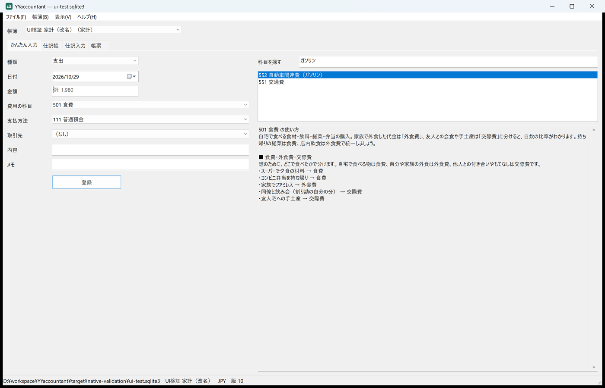
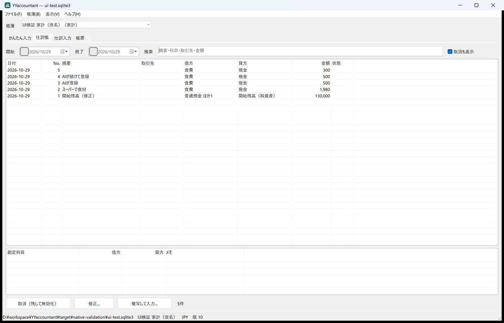
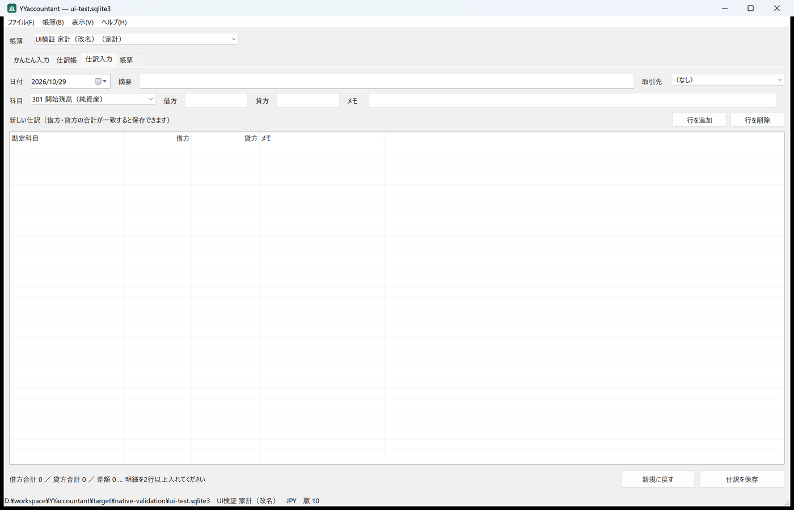
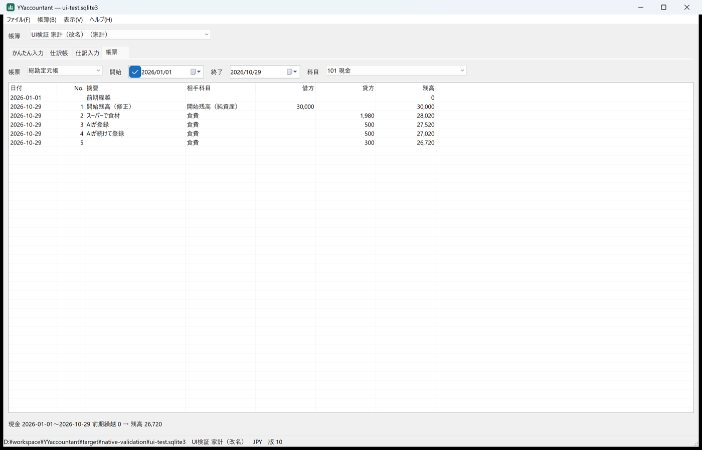

# Windowsネイティブ画面の追加と検証（2026-10-29）

YYprojectの `yyprojectw` と同じ形で、Windows専用の実行ファイル `yyaccountantw` を追加した。標準のWin32コントロール（コンボボックス、日付選択、リストビュー、タブ、ステータスバー）だけで作り、yyeditorの `yy-ui-win` には依存しない。計算・検証・保存はcoreをそのまま使う。

## 方針

- 範囲は日々の記帳に必要な画面に絞った: かんたん入力（科目検索と使い分けの説明つき）、仕訳帳（絞り込み・取消・修正・複写）、複数行の仕訳入力（貸借の合計と差額）、帳票4種、帳簿の作成と設定、バックアップ、仕訳CSV。債権債務・予算・計画・原価・統計はWeb UIとMCPに任せる。同じSQLiteファイルを同時に開けるので、分担しても不便が少ない。
- 他の接続の変更は `PRAGMA data_version` で検出して読み込む。保存は画面の版を `expected_revision` に使い、競合時は入力欄を残して最新を読み込む。
- 自己検証は `yyaccountantw --ui-smoke-test DIR` で行い、`tools/test_native.py` が実プロセスとして終了を待ち、作られたSQLiteを別に確認する。固定の待ち時間は使わない（操作はウィンドウへの同期メッセージ）。

## 実行した検証（Windows 11 Pro、表示倍率200%、rustc 1.92.0）

| 検証 | 結果 |
|---|---|
| `cargo fmt --all -- --check` | 成功 |
| `cargo clippy --workspace --all-targets --locked -- -D warnings` | 警告なし |
| `cargo test --workspace --locked` | 22件成功（core単体6、core結合10、文書1、app 2、yyaccountantw 3） |
| `python tools/test_mcp.py target/release/yyaccountant.exe` | 成功 |
| `python tools/test_web.py target/release/yyaccountant.exe --browser`（Chromium） | 成功 |
| `python tools/test_native.py target/release/yyaccountantw.exe` | 成功（下記の全項目） |

`--ui-smoke-test` で確認した主な項目:

- 帳簿作成フォームで家計の帳簿を作成。貸借が一致しない2行の仕訳は保存せず、3行目（Enterで追加）で「差額 0 … 貸借一致」となって保存。
- かんたん入力で「１，９８０円」を1,980円として登録。JPYで「12.5」は「小数0桁以内」で拒否。
- 「ガソリン」で自動車関連費・交通費が候補に出て、選ぶと科目と使い分けの説明を表示。
- 取消は削除せず一覧から外れ、「取消も表示」で確認・解除できる。金額「1980」で検索できる。修正は同じ仕訳番号（No.1）で置き換わる。
- 別の接続（AI-test）が登録した仕訳を1秒ごとの確認で読み込む。古い版のまま保存すると「他の利用者が先に更新しました」で拒否し、入力した金額を残したまま最新を読み込み、再保存で登録される。
- 帳票: 試算表 借方・貸方とも133,280で一致、貸借対照表 資産126,720＝負債・純資産126,720、現金の元帳残高26,720（30,000−1,980−500−500−300）。
- 個人事業主の地代家賃100,000円・事業割合30%で事業主貸70,000円。家計に切り替えると事業割合の欄を隠す。
- 860×600と1400×900（96DPI換算）で全ページのコントロールがはみ出さず重ならない。150%へのDPI変更でも同じ。読み取り専用では登録ボタンが無効でEnterでも保存しない。
- SQLiteの `entry_lines.debit` `credit` は全行 `text`、取消していない仕訳はPythonの `Decimal` で貸借一致、監査の操作者は `UI-test` と `AI-test`。

## 画面

| かんたん入力 | 仕訳帳 |
|---|---|
|  |  |
| **仕訳入力** | **帳票（総勘定元帳）** |
|  |  |

## 検証で見つけて直した不具合

- **最小幅で入力欄がはみ出す**: 横に並べる欄の幅を計算するとき、後ろに続く見出しの幅を引いていなかった（配置の検査で発見）。見出しの幅を含めて計算し、仕訳入力の「行を追加」「行を削除」は入力欄の下の行に移した。
- **支出の科目の既定が投資口座**: 支出の候補が科目コード順で、資産（投資・証券口座）が費用より先に並んでいた（画面の確認で発見）。費用の科目を先に並べた。
- **既存のclippy警告**: `core/src/chart.rs` で試験モジュールの後に `markdown()` があり、`items_after_test_module` で `-D warnings` が失敗していた。関数を試験モジュールの前に移した（内容は変更なし）。

## 未確認

- CI（`windows-2022`）での `tools/test_native.py` の実行結果は、この記録の時点では未確認。ランナーで画面を取得できない場合は `ui-smoke.txt` に `note` として記録し、検証自体は続ける。
- MinGW（`x86_64-pc-windows-gnu`）でのビルドは未確認。マニフェストはMSVCのリンカーでだけ埋め込む。
