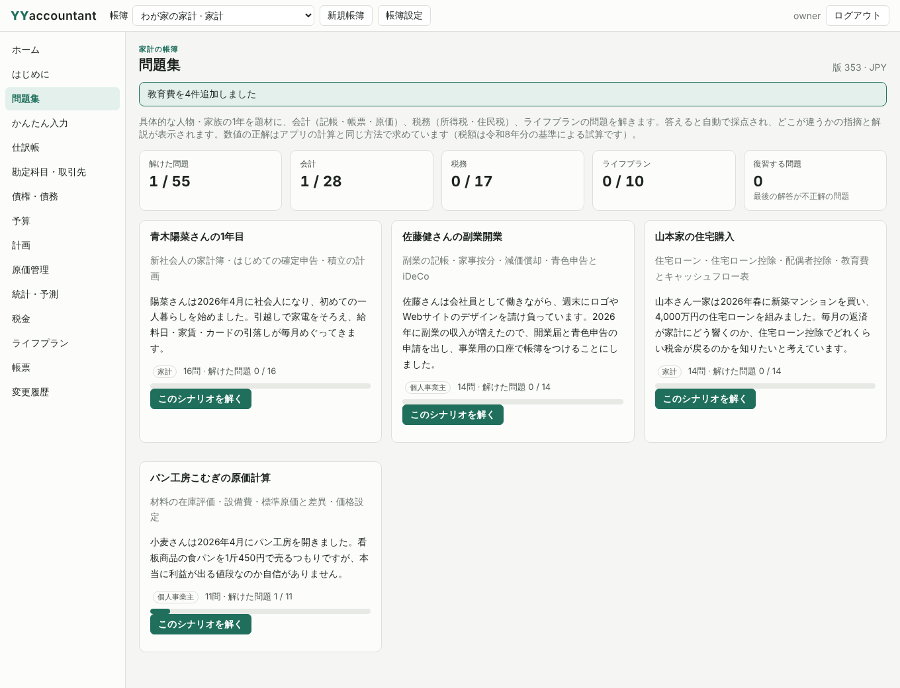
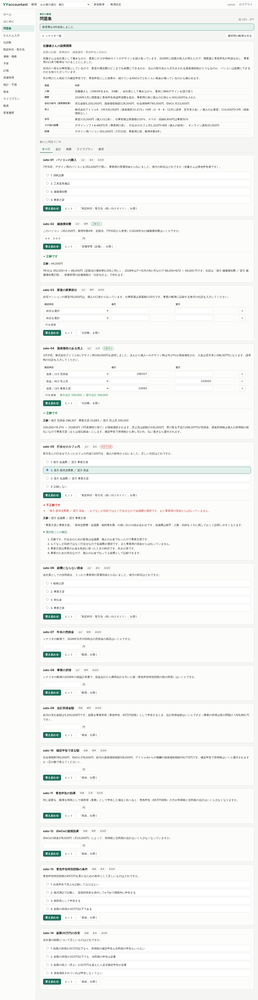
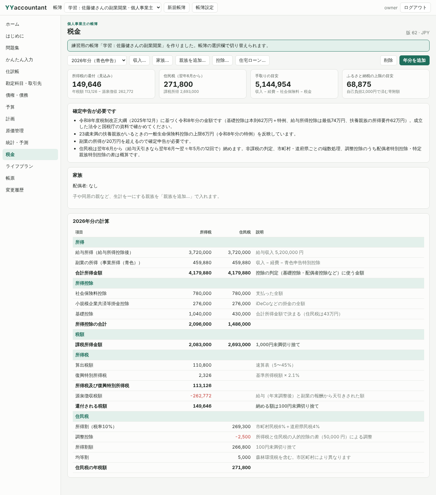

# 問題集（シナリオで学ぶ会計・税務・ライフプラン）の追加と検証（2026-10-30）

## 要求

会計と税務とライフプランの勉強ができるように、具体的な問題集つきの具体的なシナリオに発展させる。

## 追加したもの

- `core/src/study.rs`：4つのシナリオと55問（会計28・税務17・ライフプラン10）。シナリオごとに帳簿をメモリー上で組み立て、数値の正解はその帳簿に対する帳票・税額・ライフプラン・原価・返済予定の計算から求める。
  - 青木陽菜さんの1年目（新社会人の家計・医療費控除・積立）16問
  - 佐藤健さんの副業開業（家事按分・源泉徴収・減価償却・青色申告・iDeCo）14問
  - 山本家の住宅購入（住宅ローン・配偶者控除・住宅ローン控除・教育費・キャッシュフロー表）14問
  - パン工房こむぎの原価計算（移動平均・設備費・標準原価・差異・材料費の振替）11問
- 採点：選択（選択肢ごとの解説）、仕訳（科目の過不足・借方貸方の逆・金額・左右不一致を指摘）、数値（端数処理・符号の指摘）。
- 解答の記録（SQLite版3の `study_attempts`、版1・版2から移行）と、分野・シナリオごとの正解数と復習。
- シナリオから「練習用の帳簿」を作る機能。
- MCPツール `study_list` `study_answer` `study_practice_book`、Web UIの「問題集」、チュートリアルの第4章、`docs/user/study.md`（生成・同期試験つき）。

## 実行した検証（Linux、rustc 1.97.0）

| 検証 | 結果 |
|---|---|
| `cargo fmt --all -- --check` | 成功 |
| `cargo clippy --workspace --all-targets --locked -- -D warnings` | 警告なし |
| `cargo test --workspace --locked` | 33件成功（core単体11、books 11、docs 3、study 6、app 2） |
| `python tools/test_mcp.py target/release/yyaccountant` | 成功 |
| `python tools/test_web.py target/release/yyaccountant --browser`（Chromium） | 成功 |

Windowsのネイティブ画面（`yyaccountantw`）はこの環境では作れないため、ビルドと `tools/test_native.py` は未確認。ネイティブ画面のコードは変更していない（共通のcoreに `Book::blank` と問題集、SQLite版3を追加し、チュートリアルの文章が1章増えた）。CI（`windows-2022`）の結果で確認する。

## 答えを手計算と照合して分かったこと

- 給与所得：2,370,000円を「×70%−8万円」で計算すると1,579,000円になるが、660万円未満は所得税法の別表第五により収入を4,000円単位に切り捨てるため、正しくは1,577,600円。税額エンジンは正しく、最初に書いた解説の方が誤っていたので直した。医療費控除（所得の5%を引く）もこの値で61,120円になる。
- 住宅ローン控除：年末残高39,281,382円と限度額3,000万円の少ない方×0.7%＝210,000円のうち、所得税から133,600円、残り76,400円を住民税（課税所得の5%と97,500円の範囲内）から引く。
- 山本家の「現状」のキャッシュフロー表では、2人の私立大学が重なる2042〜2046年に金融資産がマイナスになり、2045年末に−2,362,528円で最少になる。問題はこの「資金が足りなくなる時期」を読ませる。

## 画面

| | |
|---|---|
|  |  |
|  | |

## 追記：Windowsのネイティブ画面への問題集の追加

- ネイティブ画面に14ページ目「問題集」を追加した。記録の画面の共有コントロール（表示の切り替え＝シナリオ、復習だけ表示、問題の一覧、問題文と選択肢、進み具合）を使い、「答える...」で形式ごとの入力欄（選択肢・数値・仕訳4行）を開いて採点し、結果と解説を読み取り専用の窓に表示する。「ヒント」「シナリオを読む」「練習用の帳簿を作る」もある。帳簿がなくても使え、読み取り専用では採点だけで記録しない。
- 内容とフォームは窓に依存しない `app/src/native/study_page.rs` に置き、`native.rs` には共有コントロールへの表示とボタンの振り分けだけを足した。
- 問題集の手順を `--ui-smoke-test` に追加した（仕訳の借方貸方の逆→不正解、正解、数値・選択の採点と記録、進み具合と復習、ヒント・シナリオの文章、シナリオの切り替え、練習用の帳簿、読み取り専用での採点のみ）。

### 検証の範囲

- Linuxでは、ネイティブ画面の窓に依存しないモジュール（`sheets.rs`・`records.rs`・`planning.rs`・`study_page.rs`）を、Win32のフォーム窓だけを同じ定義の型に置き換えた一時的なクレートで型検査し、単体試験7件（既存4件＋追加3件）とclippyを通した。このとき、全セクションのフォームを確かめる既存の試験が問題集で失敗することを見つけ、問題集を対象外にして直した（Windowsでしか動かない試験なので、CIで初めて落ちるところだった）。
- `native.rs` と `smoke.rs` の変更はWindows用のコードで、この環境ではビルドも実行もしていない（rustfmtでの構文の確認と、呼び出し先のAPIとの照合のみ）。Windows用の型検査に使う `cargo-xwin` の導入は権限の判断で止められた。CI（`windows-2022`）の `cargo clippy`・`cargo test`・`tools/test_native.py` の結果で確認する。
