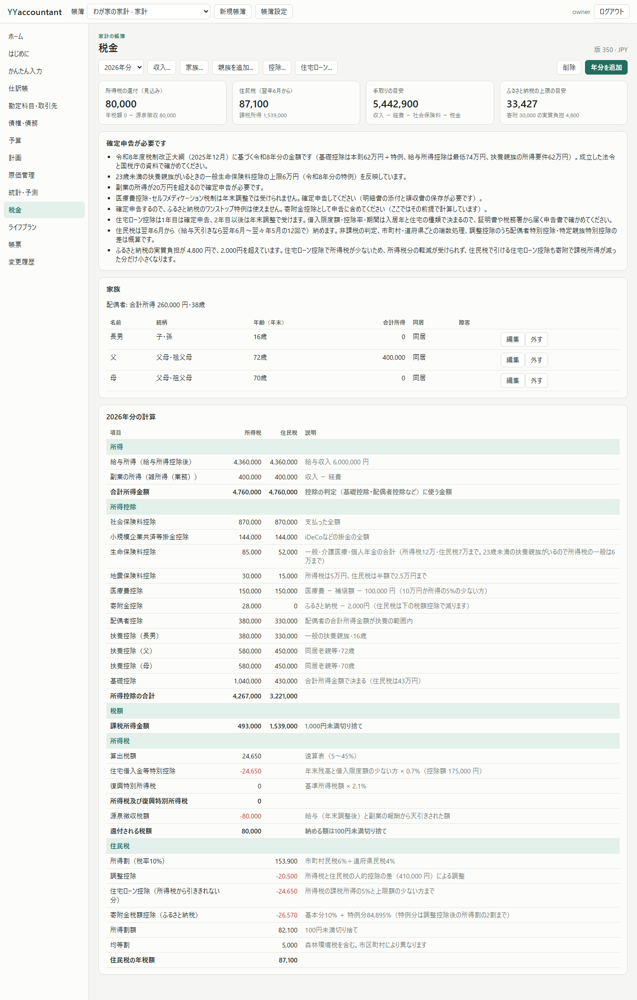
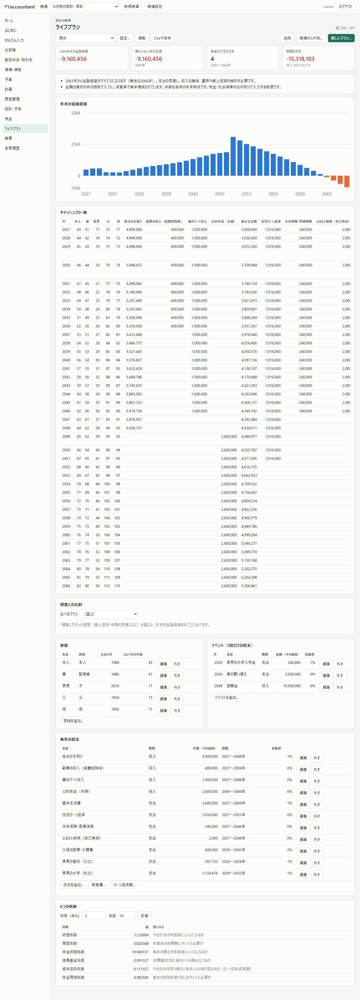
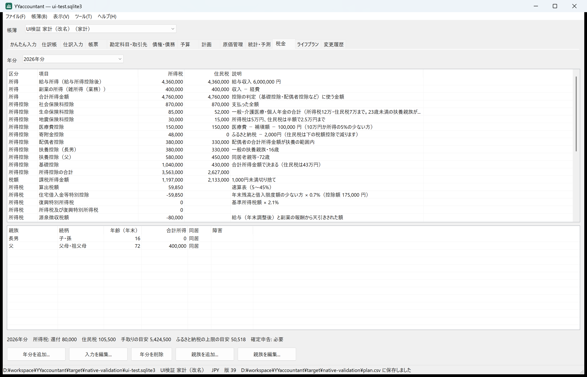
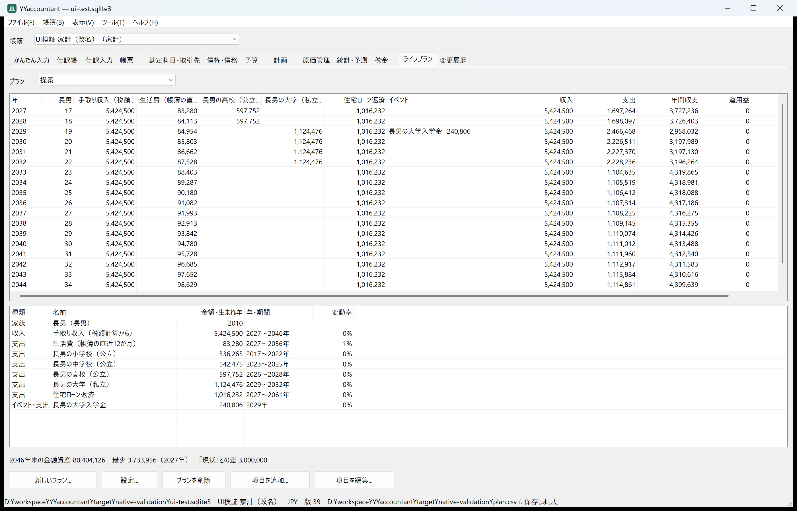

# チュートリアル・税額計算・ライフプランの追加と検証（2026-10-29）

会計と税金の知識が十分でない人向けのチュートリアル、個人の財務管理のための所得税・住民税の計算、FPがライフプランを作って提案するための機能を追加した。

## 要望と範囲

- 想定する人: 副業をしている会社員。妻と子、老いた父母と同居し、住宅ローンを組み、保険とふるさと納税をしている。
- 必要な税金: 所得税（復興特別所得税を含む）と住民税。確定申告の要否、還付・納付の見込み、ふるさと納税の上限の目安。
- 対象外: 相続（要望どおり）、e-Taxとの連携（要望どおり）。あわせて贈与、株式・不動産・譲渡の所得、ひとり親・寡婦・勤労学生、外国税額、住民税の非課税の判定も扱っていない。

## 方針

- 金額基準は年分ごとの表（`tax::Rules`）で持ち、対応していない年分は計算しない。税制は毎年のように変わるので、画面と文書では「試算」と示し、公式の案内で確かめるよう促す（AGENTS.mdの方針）。
- 令和8年分は、令和8年度税制改正大綱（2025年12月19日与党公表）を解説した税理士法人・会計メディアの記事で金額を確かめた（基礎控除の本則62万円＋特例、給与所得控除の最低74万円、扶養親族の所得要件62万円、23歳未満の扶養親族がいるときの一般生命保険料控除の上限6万円）。成立した法令と国税庁の資料での確認はまだ。
- 計算はすべて `rust_decimal`。入力は帳簿の中に年分・プランとして保存し（SQLiteの新しいテーブル、金額はTEXT）、変更は他と同じく版の競合検出と監査を通る。
- チュートリアルは `core/src/tutorial.rs` を1つの元にし、Web UIの「はじめに」、ネイティブ画面のヘルプメニュー、MCPの `tutorial`、`docs/user/tutorial.md`（試験で一致を確認）が同じ内容を出す。

## 実行した検証（Windows 11 Pro、表示倍率200%、rustc 1.92.0）

| 検証 | 結果 |
|---|---|
| `cargo fmt --all -- --check` | 成功 |
| `cargo clippy --workspace --all-targets --locked -- -D warnings` | 警告なし |
| `cargo test --workspace --locked` | 30件成功（税額計算3件、ライフプラン2件、移行と保存1件、チュートリアル文書1件を追加） |
| `python tools/test_mcp.py target/release/yyaccountant.exe` | 成功 |
| `python tools/test_web.py target/release/yyaccountant.exe --browser`（Chromium） | 成功 |
| `python tools/test_native.py target/release/yyaccountantw.exe` | 成功（114項目、13画面を保存） |

手計算と一致を確かめた例（令和8年分）: 給与600万円（源泉徴収8万円、社会保険料87万円）、副業の雑所得40万円、妻（パート年収100万円）、16歳の子、同居の父（72歳・所得40万円）と母（70歳）、一般生命保険料10万円・介護医療保険料4万円・地震保険料3万円、医療費25万円、ふるさと納税5万円、住宅ローン残高2,500万円（限度額4,000万円・0.7%）。

| 項目 | 所得税 | 住民税 |
|---|---|---|
| 合計所得金額 | 4,760,000 | 4,760,000 |
| 生命保険料控除（一般は23歳未満の扶養親族の特例で上限6万円の表） | 85,000 | 52,000 |
| 所得控除の合計 | 4,143,000 | 3,077,000 |
| 課税所得 | 617,000 | 1,683,000 |
| 算出税額・所得割 | 30,850 | 168,300 |
| 住宅ローン控除 | −30,850 | −30,850（課税所得の5%まで） |
| 調整控除（人的控除差41万円） | | −20,500 |
| 寄附金税額控除（特例分は所得割の2割29,560円まで） | | −34,360 |
| 年税額 | 0（源泉徴収8万円が還付） | 87,500（均等割5,000円を含む） |

ふるさと納税の上限の目安は36,819円で、5万円の寄附は上限を超えると注意に出る。デモ（寄附3万円、iDeCoあり）では、住宅ローン控除で所得税が0になるため、実質負担が2,000円ではなく4,800円になることを実プロセスの試験で確かめ、その理由を注意に出すようにした。

## 画面

| Web UI 税金 | Web UI ライフプラン |
|---|---|
|  |  |
| **ネイティブ画面 税金** | **ネイティブ画面 ライフプラン** |
|  |  |

[Web UIの「はじめに」（チュートリアル）](images/tax-lifeplan-2026-10-29/web-guide.png)

## 検証で見つけて直したこと

- ライフプランの表で、子の小学校・中学校のように表の期間の前に終わる教育費も列になっていた（画面の確認で発見）。期間に1年もかからない収支は列を作らないようにした。
- 説明欄の金額に桁区切りがなかった（画面の確認で発見）。`num::grouped` で区切るようにした。
- ネイティブ画面で提案を複製すると、フォームの既定の年数（30年）で元のプラン（20年）と期間がずれた（UIの自己検証で発見）。新しいプランのフォームの既定値を、表示中のプランの期間と利回りにした。
- 追加したメニュー（キャッシュフロー表のCSV、6つの係数、チュートリアル）がダイアログ用のコマンド一覧になく、何も起きなかった（UIの自己検証で発見）。一覧に加えた。
- 住宅ローン控除とふるさと納税を併用すると実質負担が2,000円を超える（MCPの実プロセス試験で発見。計算は正しく、説明がなかった）。注意を追加した。

## 未確認

- 令和8年分の金額は大綱の解説記事に基づく。成立した法令・国税庁の様式との突き合わせ、年末調整・確定申告書等作成コーナーの結果との照合はしていない。
- 住民税の調整控除で、配偶者特別控除・特定親族特別控除の人的控除差を0とした（概算）。市町村・道府県ごとの端数処理、非課税の判定はしていない。
- 住宅ローン控除の借入限度額は入居年と住宅の種類で決まり、ここでは利用者が入力する（2026年以後の入居の表は持っていない）。
- 教育費の目安は文部科学省の調査の全国平均。
- CI（`windows-2022`・`ubuntu-24.04`）での実行結果は、この記録の時点では未確認。
