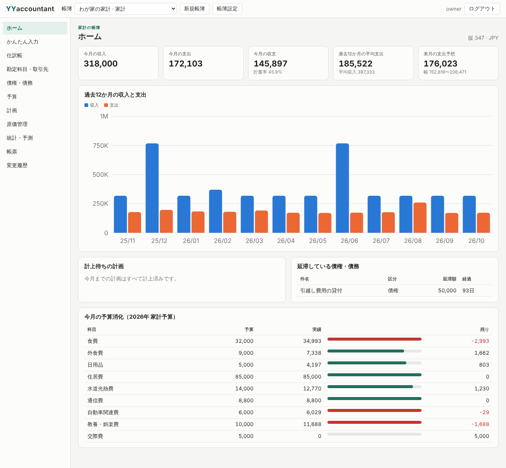
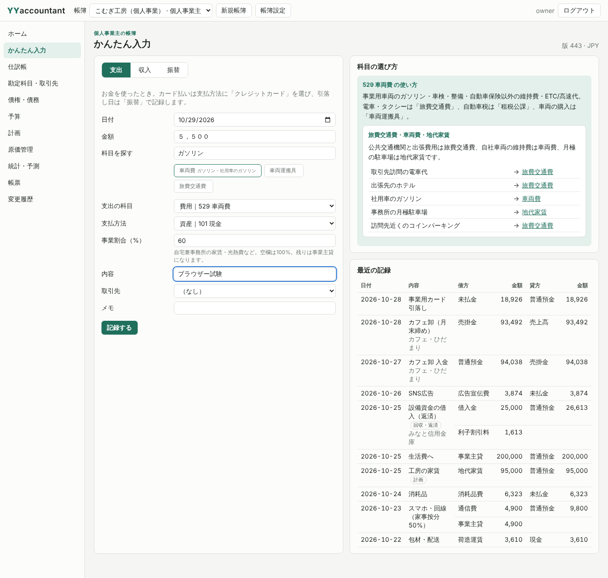
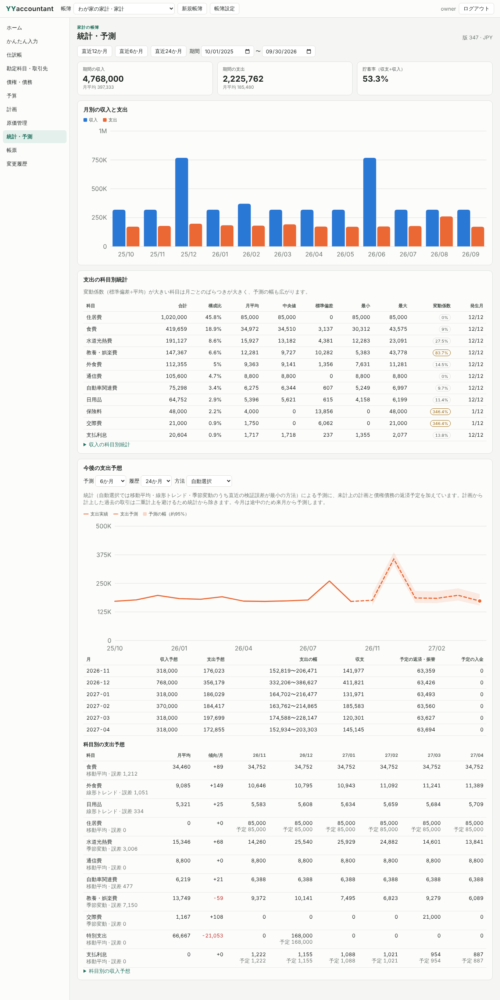
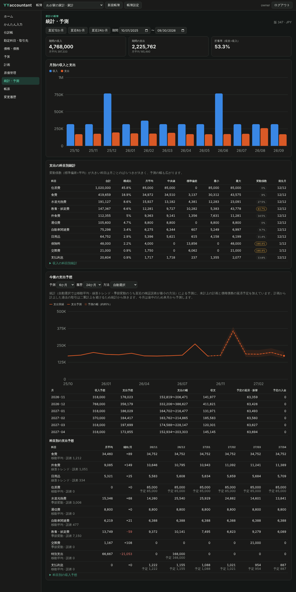
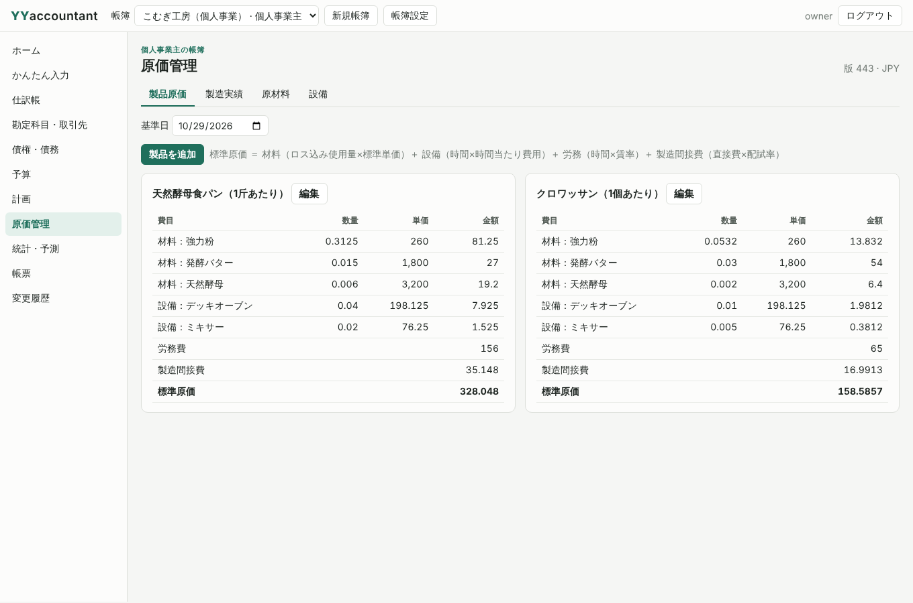
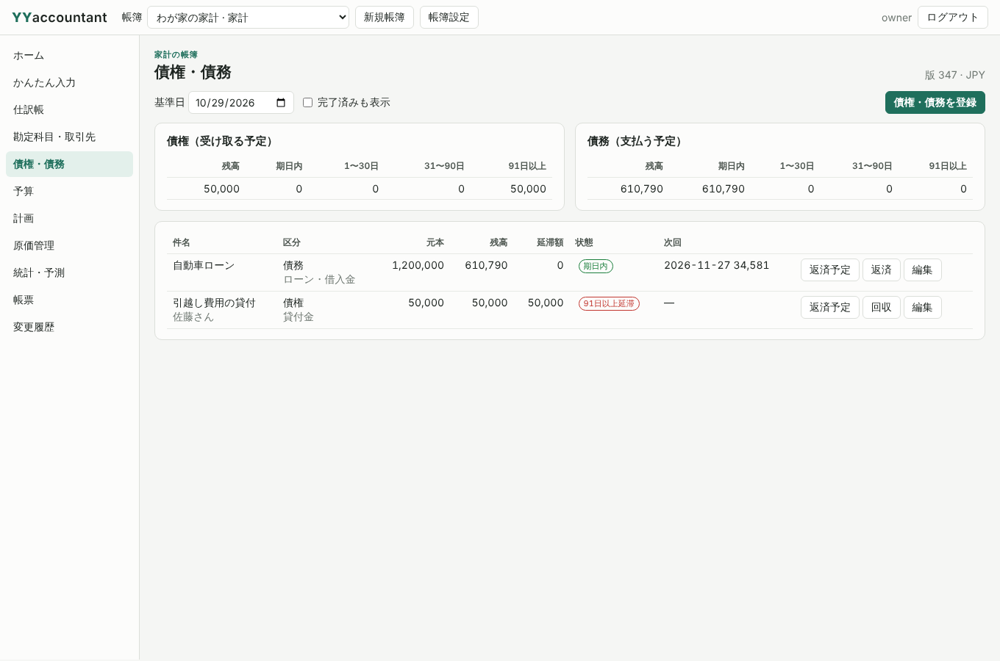
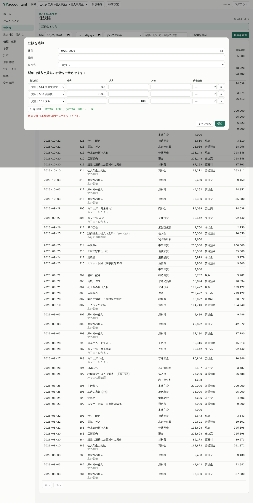
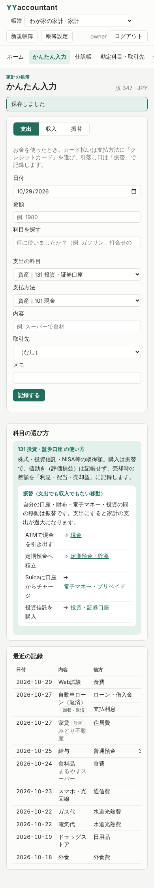

# 初期実装と検証（2026-10-29）

[初期方針](../proposals/yyaccountant.md)に沿って、core（帳簿モデル・十進数計算・SQLite）とapp（CLI・stdio MCP・Web UI）を実装した。

## 実行した検証（Linux、rustc 1.97.0）

| 検証 | 結果 |
|---|---|
| `cargo fmt --all -- --check` | 成功 |
| `cargo clippy --workspace --all-targets --locked -- -D warnings` | 警告なし |
| `cargo test --workspace --locked` | 19件成功（core単体6、core結合10、文書1、app 2） |
| `python tools/test_mcp.py target/release/yyaccountant` | 成功 |
| `python tools/test_web.py target/release/yyaccountant --browser`（Chromium） | 成功 |

Windowsでの実行はこの記録の時点では未確認。CI（`windows-2022`）の結果で確認する。

## 確認した主な値

- 0.10を3回記帳した合計が0.3（USD、小数2桁）。JPYで0.001や1234.5の金額、JSON数値の小数は拒否。SQLiteの `entry_lines.debit` は全行 `text` 型。
- 元利均等: 元本1,200,000円・年2.4%・12回の毎回の支払額は101,305円（Pythonの`decimal`で101,304.76…を確認）、初回利息2,400円、元本合計は1,200,000円ちょうど、最終回の残高0。
- 家事按分: 100,001円・事業割合30%は地代家賃30,000円（30,000.3を四捨五入）、事業主貸70,001円。
- 原価: 小麦粉を10kg×180円・10kg×220円仕入れた移動平均200円、12kg払出し後の在庫8kg・1,600円。食パンの標準原価242円（材料92.5＋設備7.5＋労務120＋間接費22）、40斤の実際原価10,890円・標準9,680円・差異1,210円。オーブン（600,000円・5年・年1,000時間・運転費30円）の時間当たり費用150円、初年度（7〜12月）の償却60,000円、償却合計600,000円。
- 予測: 毎月1,000円ずつ増える食費の履歴に対し、自動選択は線形トレンドを選び誤差0。計画から計上した家賃は履歴から除かれ、予定として85,000円が加算される。
- デモDB: 家計・パン工房とも貸借対照表が一致。冬の光熱費・夏の娯楽費・12月の賞与が季節変動で翌年の同月に現れる。

## 検証で見つけて直した不具合

- **予測の月ずれ**: 基準日の月を途中として除外しているのに、予測の先行月数を1から数えていたため、季節変動の賞与が1か月ずれていた（実データの確認で発見）。先行月数を2から数えるよう修正し、試験の期待値を手計算で見直した。
- **在庫不足後の移動平均**: 払出しが在庫を超えた後の仕入で平均単価が負になり、材料費がマイナスになった。不足分を次の受入単価で評価し直すよう修正。
- **画面の描画競合**: 遅い画面の読み込みが後から完了して、切り替えた先の画面を上書きしていた（ダーク表示の試験で発見）。描画に連番を付け、古い結果を捨てるよう修正。
- **CSP違反**: `style` 属性がCSPで拒否され、メーターや凡例の色が出ていなかった。CSSOMで指定するよう修正し、ブラウザー試験でCSP違反を含むコンソールエラーを失敗にした。
- **科目の選択肢が空**: 別の帳簿で使った科目IDを記憶していたため、帳簿を切り替えると選択欄が空になった。記憶を帳簿ごとにし、該当しない場合は先頭を選ぶよう修正。

## 画面

| | |
|---|---|
|  |  |
|  |  |
|  |  |
|  |  |
